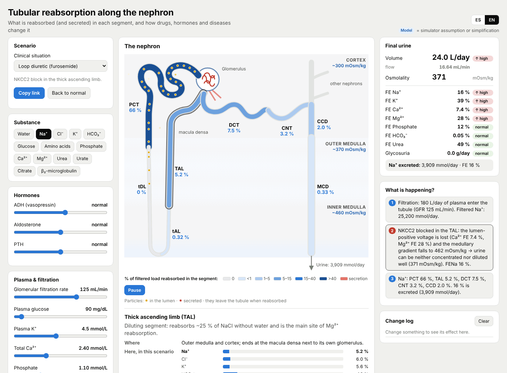

# Tubular reabsorption along the nephron — interactive simulator

**Live demo:** https://ferasmed-dev.github.io/nephron-reabsorption/ · English: https://ferasmed-dev.github.io/nephron-reabsorption/?lang=en



An interactive, bilingual (ES/EN) teaching simulator of **what is reabsorbed and secreted in each segment of the nephron**: proximal convoluted tubule, thin descending and ascending limbs, thick ascending limb, distal convoluted tubule, connecting tubule, and the cortical and medullary collecting duct. It follows 14 substances (water, Na⁺, Cl⁻, K⁺, HCO₃⁻, glucose, amino acids, phosphate, Ca²⁺, Mg²⁺, urea, urate, citrate, β₂-microglobulin) and shows how diuretics, hormones and classic tubulopathies change their handling.

> Teaching tool · not for clinical use.

## What it shows

- **A nephron diagram** coloured segment by segment by the % of the filtered load each segment reabsorbs (blue ramp = reabsorption, red = secretion). Animated particles flow along the tubule and leave it when they are reabsorbed; secreted particles enter from outside. The medullary interstitium darkens with its osmolality.
- **Click any segment** to see its apical/basolateral transporters for each substance, its regulation, the drugs that act there and the clinical correlates. A bar list shows what that segment reabsorbs in the current scenario.
- **Live charts:** the % of the filtered load left in the lumen along the nephron (with an optional log scale), the % reabsorbed per segment (diverging bars), and the tubular-fluid osmolality profile. When the scenario differs from normal, the normal values are shown as a dashed comparison. Every chart has a data-table view.
- **Final urine:** volume, flow, osmolality, fractional excretions (Na⁺, K⁺, Ca²⁺, Mg²⁺, phosphate, HCO₃⁻, urea) and glycosuria, each flagged against reference ranges.
- **"¿Qué está pasando?" / "What is happening?"** explains each active mechanism in plain language with the live numbers. A change log records the effect of each change you make (FENa, FEK, urine volume and osmolality before → after).
- **Controls:** 17 clinical scenarios, ADH, aldosterone and PTH, GFR, plasma glucose, K⁺, Ca²⁺ and phosphate, and six drugs (furosemide, thiazide, amiloride, spironolactone, acetazolamide, SGLT2 inhibitor) that can be combined.

## Curriculum fit

For students and teachers at **any Spanish medical faculty**. The topic sits in the shared core of the Grado en Medicina (Orden ECI/332/2008):

| | |
|---|---|
| System / specialty | Renal — physiology, pathophysiology, nephrology, pharmacology |
| ECI/332/2008 modules | **I** Morfología, estructura y función del cuerpo humano (Fisiología renal); **III** Formación clínica humana (Nefrología, Endocrinología); **IV** Procedimientos diagnósticos y terapéuticos (Farmacología: diuréticos) |
| Typical subjects | Fisiología humana · Fisiopatología · Farmacología · Patología médica / Nefrología · Endocrinología |
| MIR relevance | High: diuretic sites and side effects, Bartter vs Gitelman, Liddle, Fanconi, central vs nephrogenic DI, SGLT2 inhibitors, PTH and phosphate handling come up repeatedly |

Terminology follows standard Castilian Spanish medical usage (TCP, RAG, TCD, túbulo colector…) and standard English, so it reads naturally at any faculty.

## For teachers

Every scenario has a deep link that can be projected or shared. Add `&lang=en` for English, `&sub=<substance>` to choose the substance shown (`water, na, cl, k, hco3, glucose, aa, pi, ca, mg, urea, urate, citrate, b2m`) and `&seg=<segment>` to open a segment (`pct, tdl, atl, tal, dct, cnt, ccd, mcd`). The **Copy link** button copies the current view.

| Scenario | Link |
|---|---|
| Normal | https://ferasmed-dev.github.io/nephron-reabsorption/?preset=normal |
| Dehydration (maximal ADH) | https://ferasmed-dev.github.io/nephron-reabsorption/?preset=dehydration&sub=water |
| Central diabetes insipidus | https://ferasmed-dev.github.io/nephron-reabsorption/?preset=centralDI&sub=water |
| Nephrogenic diabetes insipidus | https://ferasmed-dev.github.io/nephron-reabsorption/?preset=nephrogenicDI&sub=water |
| Loop diuretic (furosemide) | https://ferasmed-dev.github.io/nephron-reabsorption/?preset=furosemide&seg=tal |
| Thiazide | https://ferasmed-dev.github.io/nephron-reabsorption/?preset=thiazide&sub=ca&seg=dct |
| Amiloride | https://ferasmed-dev.github.io/nephron-reabsorption/?preset=amiloride&sub=k&seg=ccd |
| Acetazolamide | https://ferasmed-dev.github.io/nephron-reabsorption/?preset=acetazolamide&sub=hco3 |
| SGLT2 inhibitor | https://ferasmed-dev.github.io/nephron-reabsorption/?preset=sglt2i&sub=glucose |
| Hyperglycaemia (320 mg/dL) | https://ferasmed-dev.github.io/nephron-reabsorption/?preset=hyperglycemia&sub=glucose |
| Hyperaldosteronism | https://ferasmed-dev.github.io/nephron-reabsorption/?preset=hyperaldosteronism&sub=k&seg=ccd |
| Liddle syndrome | https://ferasmed-dev.github.io/nephron-reabsorption/?preset=liddle&seg=ccd |
| Bartter syndrome | https://ferasmed-dev.github.io/nephron-reabsorption/?preset=bartter&sub=ca&seg=tal |
| Gitelman syndrome | https://ferasmed-dev.github.io/nephron-reabsorption/?preset=gitelman&sub=mg&seg=dct |
| Fanconi syndrome | https://ferasmed-dev.github.io/nephron-reabsorption/?preset=fanconi&sub=pi&seg=pct |
| Primary hyperparathyroidism | https://ferasmed-dev.github.io/nephron-reabsorption/?preset=hyperparathyroidism&sub=pi |
| Non-PTH hypercalcaemia (CaSR) | https://ferasmed-dev.github.io/nephron-reabsorption/?preset=hypercalcemia&sub=ca&seg=tal |

Suggested uses: compare `bartter` with `gitelman` for urinary Ca²⁺; turn on furosemide and then add a thiazide (sequential nephron blockade); raise plasma glucose step by step to find the renal threshold; switch between `centralDI` and `dehydration` with *Water* selected.

## Presets: expected results (model output)

GFR 125 mL/min unless stated. FE = fractional excretion.

| Scenario | Urine L/day | Uosm | FENa | FEK | FECa | FEMg | FEPi | FEHCO₃ | Glycosuria g/day |
|---|---|---|---|---|---|---|---|---|---|
| Normal | 1.41 | 648 | 0.53 % | 12.6 % | 1.20 % | 3.8 % | 11.7 % | 0.05 % | 0 |
| Dehydration | 0.43 | 1200 | 0.11 % | 13.0 % | 1.20 % | 3.8 % | 11.7 % | 0 % | 0 |
| Central DI | 17.2 | 59 | 0.67 % | 14.0 % | 1.20 % | 3.8 % | 11.7 % | 0.05 % | 0 |
| Nephrogenic DI | 8.64 | 102 | 0.44 % | 12.5 % | 1.20 % | 3.8 % | 11.7 % | 0.05 % | 0 |
| Furosemide / Bartter | 24.0 | 371 | 15.5 % | 38.5 % | 7.36 % | 27.5 % | 11.7 % | 0.05 % | 0 |
| Thiazide | 3.29 | 658 | 2.92 % | 15.7 % | 0.18 % | 5.4 % | 11.7 % | 0.05 % | 0 |
| Gitelman | 3.49 | 659 | 3.19 % | 15.9 % | 0.15 % | 6.9 % | 11.7 % | 0.05 % | 0 |
| Amiloride | 3.09 | 648 | 2.86 % | 7.5 % | 1.20 % | 3.8 % | 11.7 % | 0.73 % | 0 |
| Acetazolamide | 3.94 | 655 | 3.47 % | 21.6 % | 4.13 % | 4.5 % | 11.7 % | 29.5 % | 0 |
| SGLT2 inhibitor | 2.17 | 651 | 0.84 % | 14.4 % | 1.62 % | 3.9 % | 11.7 % | 0.05 % | 55.5 |
| Hyperglycaemia 320 mg/dL | 2.15 | 642 | 0.40 % | 11.5 % | 0.98 % | 3.7 % | 11.7 % | 0.05 % | 101 |
| Hyperaldosteronism | 1.10 | 646 | 0.05 % | 15.2 % | 1.20 % | 3.8 % | 11.7 % | 0 % | 0 |
| Liddle | 1.22 | 651 | 0.13 % | 17.9 % | 1.20 % | 3.8 % | 11.7 % | 0.27 % | 0 |
| Fanconi | 3.32 | 654 | 2.70 % | 19.9 % | 3.43 % | 4.4 % | 53.1 % | 25.9 % | 2.7 |
| Primary hyperparathyroidism | 1.90 | 630 | 1.03 % | 14.9 % | 2.38 % | 13.2 % | 27.8 % | 0.05 % | 0 |
| Non-PTH hypercalcaemia | 4.58 | 387 | 2.00 % | 17.9 % | 19.2 % | 30.5 % | 8.2 % | 0.05 % | 0 |

In Fanconi, amino-acid FE is 27 % and β₂-microglobulin excretion is ~220 mg/day (vs ~0.4). In hyperparathyroidism, Ca²⁺ excretion is ~7.4 mmol/day (≈300 mg, hypercalciuria) even though distal reabsorption rises.

## How the model works

A steady-state, single-pass mass balance (`src/model.js`, pure functions, no DOM). For each substance:

1. **Filtered load** `F = GFR × P × f_uf`, where `f_uf` is the ultrafilterable fraction (Ca²⁺ 0.6, Mg²⁺ 0.7, phosphate 0.95, others 1).
2. **Proximal tubule.** A fraction of `F` is reabsorbed (glomerulotubular balance):
   - Na⁺: `f = 0.66 × (0.8 + 0.2·PCT) × (0.62·NHE3_eff + 0.08·glucose term + 0.30) × osmotic-hold factor`.
   - Other passive solutes (K⁺, Cl⁻, Ca²⁺, Mg²⁺) scale with the Na⁺ fraction, and water follows Na⁺ isosmotically.
   - **Glucose** has two transport-maximum stages: SGLT2, then SGLT1 on what is left. Each uses a smooth minimum (non-rectangular hyperbola, θ = 0.93): `R = [(D + Tm) − √((D + Tm)² − 4θ·D·Tm)] / 2θ`. This gives the threshold "splay".
   - **Phosphate** is Tm-limited, with TmP/GFR = 1.0 mmol/L × NaPi × PTH factor.
3. **Downstream saturable segments** (thin ascending limb, thick ascending limb, DCT, CNT, CCD, MCD). For each segment:
   - The baseline fraction of delivered load `f₀ = R₀/D₀` comes from textbook values.
   - Transporter activity `a` multiplies the odds `f₀/(1−f₀)`.
   - Capacity is limited to `1.3·a·R₀`, combined with a smooth minimum and normalised so that `R = R₀` at baseline.
   - Higher delivery is partly compensated, but never fully.
4. **K⁺ secretion** in DCT2/CNT/CCD = `base × ENaC_eff × √(Na⁺ delivery ratio) × √(distal flow ratio) × (P_K/4.5)`. ENaC_eff includes aldosterone. Reabsorption in the medullary collecting duct by the H⁺/K⁺-ATPase rises in hypokalaemia.
5. **Medullary interstitium:** `I_max = 300 + 900 × g_TAL × (0.55 + 0.45 × ADH_eff)` mOsm/kg. `g_TAL` is TAL NaCl transport relative to normal, and `ADH_eff = ADH × V2/AQP2 response`.
6. **Water in the collecting system.** The cortical duct brings fluid toward 300 mOsm/kg in proportion to ADH_eff. Final `Uosm = O_CCD + (I_max − O_CCD) × ADH_eff`, and urine volume = excreted osmoles / Uosm. Osmoles = 2·(Na⁺ + K⁺) + urea + glucose.
7. **Urea.** About 50 % is reabsorbed in the PCT. It enters the thin limbs (`0.6 × ADH_eff × F`), and the inner medullary duct reabsorbs `0.75 × ADH_eff` of what it receives (UT-A1).
8. **CaSR.** Plasma Ca²⁺ above 2.5 mmol/L lowers the TAL paracellular Ca²⁺/Mg²⁺ pathway (claudin-14) and NKCC2.

Drugs multiply transporter activities: furosemide NKCC2 ×0.15; thiazide NCC ×0.15 and TRPM6 ×0.7; amiloride ENaC ×0.2; spironolactone blocks the mineralocorticoid receptor; acetazolamide carbonic anhydrase ×0.15; SGLT2 inhibitor SGLT2 ×0.05.

### Parameters

| Parameter | Value | Basis |
|---|---|---|
| GFR | 125 mL/min (180 L/day) | Physiology (adult) |
| Plasma Na⁺ / Cl⁻ / K⁺ / HCO₃⁻ | 140 / 104 / 4.5 / 24 mmol/L | Physiology |
| Plasma glucose | 90 mg/dL | Physiology (fasting) |
| Total Ca²⁺ / Mg²⁺ / phosphate | 2.4 / 0.85 / 1.1 mmol/L | Physiology |
| Urea / urate / citrate | 5 / 0.3 / 0.1 mmol/L | Physiology |
| PCT fraction Na⁺, water | 0.66 | Physiology (textbook ~65–67 %) |
| TAL fraction Na⁺ | 0.23 (+0.02 thin ascending limb) | Physiology (~25 %) |
| DCT / CNT / CCD / MCD Na⁺ | 0.05 / 0.02 / 0.012 / 0.002 | Physiology (~5 %, ~3 % collecting system) |
| Mg²⁺ PCT / TAL / DCT | 0.20 / 0.65 / 0.10 | Physiology |
| Ca²⁺ PCT / TAL / DCT+CNT | 0.65 / 0.22 / 0.11 | Physiology |
| HCO₃⁻ PCT / TAL / distal | 0.80 / 0.12 / ~0.08 | Physiology |
| Phosphate PCT (TmP/GFR) | ~0.8 (1.0 mmol/L) | Physiology |
| Glucose Tm SGLT2 / SGLT1 | 2450 / 520 mmol/day (total ≈ 375 mg/min) | Physiology + **Model** (tuned for the 180–200 mg/dL threshold and ~55 g/day glycosuria on SGLT2 inhibitors) |
| ADH default | 0.55 | **Model** (gives Uosm ≈ 650 mOsm/kg, V ≈ 1.4 L/day) |
| Saturable capacity factor / curvature | 1.3 / 0.8 | **Model** |
| K⁺ distal secretion (DCT/CNT/CCD), MCD reabsorption | −0.01 / −0.06 / −0.04; 38 % of delivered | **Model** (FEK ≈ 13 %) |
| Drug block strengths | 80–95 % | **Model** (full-dose acute effect) |
| CaSR slope | −0.6 per mmol/L above 2.5 | **Model** |
| Interstitial osmolality | 300 + 900·g_TAL·(0.55 + 0.45·ADH_eff) | Physiology (max ~1200 mOsm/kg) + **Model** |

### Known simplifications

- **Acute, single-nephron-average model.** There is no feedback on volume status, renin–angiotensin–aldosterone, ADH or plasma values. In steady state on a diuretic, natriuresis returns to equal intake (the "braking phenomenon"); this is not modelled.
- Glomerulotubular balance is perfect. Tubuloglomerular feedback and CKD adaptation (rising FENa as GFR falls) are not modelled.
- The osmolality profile uses a long-loop (juxtamedullary) nephron for the hairpin and thin ascending limb. The mass balance uses average fractions.
- Acid–base is shown only as HCO₃⁻ handling. There is no plasma pH, titratable acid or full ammoniagenesis.
- Urate and citrate are net PCT fractions; urate secretion is not separated from reabsorption.
- β₂-microglobulin stands in for all low-molecular-weight proteins (sieving assumed 1).
- Thiazide hypocalciuria is modelled only through the DCT/CNT mechanism; the chronic proximal effect of volume contraction is not included.

## Repository layout

```
index.html            page shell
src/model.js          pure model, presets, reference ranges
src/i18n.js           ES + EN text (segment content, explanations, log)
src/ui.js             DOM, nephron SVG + particles, panels, deep links (window.__sim for checks)
src/charts.js         dependency-free SVG line and bar charts
src/styles.css        light/dark styles
tests/model.test.js   node:test suite (27 tests)
curriculum.json       topic metadata
docs/screenshot.png
```

## Run locally

No build step and no dependencies.

```bash
python3 -m http.server 8000
# open http://localhost:8000/
```

## Tests

```bash
npm test        # = node --test
```

The tests cover baseline values, each segment's role, mass balance for every substance and preset, extreme inputs (no negatives or NaN), monotonic ADH response, the glucose threshold, the expected direction of every preset, and purity (inputs are never mutated). GitHub Actions runs them on every push.

## Deploy (GitHub Pages)

Settings → Pages → *Deploy from a branch* → `main` / `(root)`. The site appears at `https://ferasmed-dev.github.io/nephron-reabsorption/`.

## References

- Boron WF, Boulpaep EL. *Medical Physiology*, 3rd ed. Elsevier; 2017 — chapters on transport of Na⁺, Cl⁻, K⁺, Ca²⁺, Mg²⁺, phosphate, organic solutes and urine concentration.
- Koeppen BM, Stanton BA. *Renal Physiology*, 6th ed. Elsevier; 2019.
- Hall JE, Hall ME. *Guyton and Hall Textbook of Medical Physiology*, 14th ed. Elsevier; 2021.
- Rose BD, Post TW. *Clinical Physiology of Acid–Base and Electrolyte Disorders*, 5th ed. McGraw-Hill; 2001.
- Yu ASL, et al. *Brenner and Rector's The Kidney*, 11th ed. Elsevier; 2020.
- Vallon V, Thomson SC. Targeting renal glucose reabsorption to treat hyperglycaemia: the pleiotropic effects of SGLT2 inhibition. *Diabetologia*. 2017;60:215–225.
- Blanchard A, et al. Gitelman syndrome: consensus and guidance from a KDIGO Controversies Conference. *Kidney Int*. 2017;91:24–33.

## Licence

MIT © 2026 Feras Elhissi
